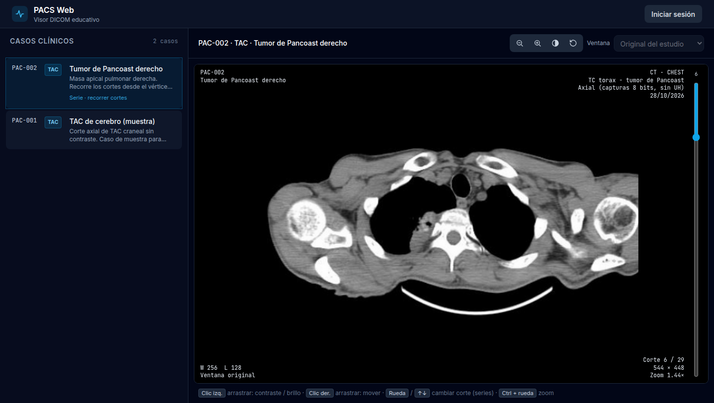
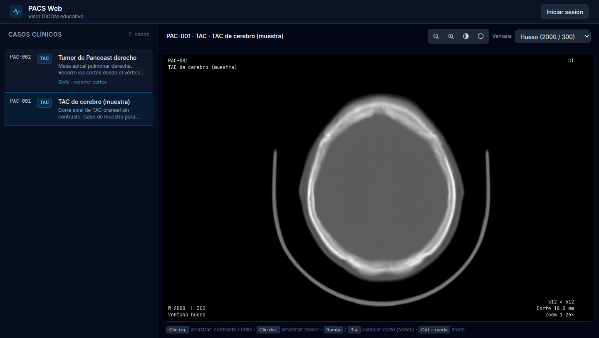
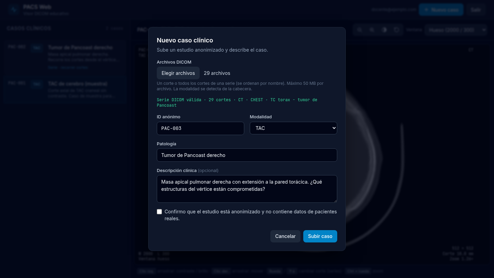

<div align="center">

# PACS Web · Visor DICOM educativo

**Plataforma web para gestionar casos clínicos y visualizar estudios radiológicos (DICOM) directamente en el navegador, pensada para estudiantes de ciencias de la salud.**

[](https://arrobaaas.github.io/Web_Dicom_Medical/)




</div>

---

## Índice
- [Qué hace](#qué-hace)
- [Capturas](#capturas)
- [Arquitectura](#arquitectura)
- [Decisiones técnicas](#decisiones-técnicas)
- [Seguridad](#seguridad)
- [Modelo de datos](#modelo-de-datos)
- [Ejecutar en local](#ejecutar-en-local)
- [Estructura del proyecto](#estructura-del-proyecto)
- [Hoja de ruta](#hoja-de-ruta)
- [Aviso](#aviso)

## Qué hace

Un PACS (*Picture Archiving and Communication System*) es el sistema con el que los hospitales almacenan y consultan imágenes médicas. Este proyecto reproduce sus funciones básicas en una aplicación web estática, sin servidor propio:

**Visor DICOM**
- Renderiza archivos `.dcm` reales en un `<canvas>`: TAC, RX, RM, etc.
- **Series (volúmenes):** permite recorrer los cortes con una barra vertical, la rueda del ratón o el teclado. El primer corte aparece al instante y el resto se precarga en segundo plano.
- **Ventana / nivel (W/L):** el contraste y el brillo se ajustan arrastrando el ratón o con presets clínicos en unidades Hounsfield (cerebro, pulmón, mediastino, hueso). Los presets solo se activan cuando la imagen tiene datos en esas unidades.
- Zoom, desplazamiento, inversión de grises y restablecer.
- **Overlay en las cuatro esquinas**, como en una estación de radiología: paciente, modalidad, región, fecha, W/L, matriz, grosor de corte, número de corte y zoom.

**Gestión de casos**
- Lista de casos clínicos con modalidad, patología y descripción, consultable sin cuenta.
- Inicio de sesión para docentes y alta de casos nuevos, subiendo un solo corte o una serie completa.
- **Validación del archivo antes de subirlo:** comprueba la firma `DICM`, detecta la modalidad desde la cabecera y **avisa si el archivo contiene datos identificativos** del paciente.

## Capturas

| Preset de ventana «hueso» sobre un TAC craneal | Alta de un caso con una serie de 29 cortes |
|:---:|:---:|
|  |  |

## Arquitectura

La aplicación está organizada en **clases ES6 con una única responsabilidad cada una**. Las dependencias se inyectan por constructor desde `main.js`, que es el único punto donde se crean las instancias. Así cada clase se puede sustituir por un doble en las pruebas; por ejemplo, la UI funciona con un repositorio falso que sirve archivos locales.

```mermaid
flowchart LR
    subgraph Navegador
        main[main.js<br/><i>composición</i>]
        UI[AppUIController<br/>lista + visor]
        Form[CaseFormController<br/>login + alta de casos]
        Model[PatientModel<br/>dominio + validación]
        Engine[DicomViewerEngine<br/>render DICOM]
        Repo[SupabaseRepository<br/>datos + archivos]
        Auth[AuthService<br/>sesión]
    end

    subgraph Supabase
        DB[(PostgreSQL<br/>tabla pacientes + RLS)]
        ST[(Storage<br/>bucket privado dicom)]
        AU[Auth]
    end

    main --> UI & Form
    UI --> Model & Repo & Engine
    Form --> Model & Repo & Auth & Engine
    Repo --> DB & ST
    Auth --> AU
    Engine -. Cornerstone.js .-> Canvas[canvas]
```

| Clase | Responsabilidad |
|---|---|
| `PatientModel` | Entidad de dominio. Convierte filas de la base (snake_case) a objetos, valida casos nuevos y traduce los códigos de modalidad DICOM (`CT` → `TAC`). |
| `SupabaseRepository` | Único punto de acceso a datos: CRUD de `pacientes`, subida de archivos, URLs firmadas y listado de series. Traduce los errores de PostgreSQL a mensajes legibles. |
| `DicomViewerEngine` | Encapsula Cornerstone: el resto de la app nunca lo usa directamente. Se encarga de la carga, las series, la W/L, el zoom y el desplazamiento, del estado del visor y de inspeccionar archivos locales. |
| `AppUIController` | Renderiza la lista de casos y conecta la barra de herramientas y el overlay con el motor del visor. |
| `CaseFormController` | Diálogos de inicio de sesión y de alta de casos: inspección de archivos, validación y progreso de la subida. |
| `AuthService` | Encapsula Supabase Auth: inicio y cierre de sesión, y avisos de cambio de sesión. |

**Flujo al abrir un caso:** `AppUIController` → `SupabaseRepository.obtenerUrlsDicom()` (lista la carpeta y firma las URLs) → `DicomViewerEngine.renderSerie()` → evento de render → `AppUIController.renderizarOverlay()`.

## Decisiones técnicas

| Decisión | Motivo |
|---|---|
| **Sin bundler ni framework** | Es una aplicación estática desplegada en GitHub Pages. Los módulos ES nativos bastan y el código se lee tal cual llega al navegador. |
| **Bucket privado + URLs firmadas** | Los archivos no tienen una URL pública permanente: cada visualización genera URLs temporales (1 h). |
| **Seguridad en la base de datos (RLS), no en el cliente** | La clave pública de Supabase es visible en el código. Lo que protege los datos son las políticas de PostgreSQL, que no se pueden saltar desde el navegador. |
| **Cornerstone servido desde el propio sitio, build *NoWebWorkers*** | Los Web Workers no se pueden cargar desde un CDN de otro origen. La build sin workers decodifica en el hilo principal, suficiente para cortes de este tamaño. |
| **Series como carpetas** (`archivo_dicom_path` terminado en `/`) | Un caso sigue siendo una sola fila en la tabla, sin un esquema extra para los cortes. El orden se toma del nombre del archivo. |
| **Protección contra condiciones de carrera** | Si se hacen clics rápidos o se mueve la rueda deprisa, las cargas que llegan tarde se descartan en vez de pisar a la imagen actual. |
| **DOM con `textContent`, nunca `innerHTML`** | Los textos de los casos vienen de la base de datos, y así se evita XSS. |
| **Versión en las URLs de CSS y JS** (`?v=`) | GitHub Pages permite al navegador guardar cada archivo 10 minutos. Sin versión, el navegador podía mezclar archivos de dos publicaciones distintas. |

## Seguridad

- **Row Level Security** en la tabla `pacientes`: lectura pública y escritura solo para usuarios autenticados.
- **Registro público desactivado:** las cuentas de docentes se crean desde el panel de Supabase.
- **Storage:** bucket privado. El servidor limita el tamaño (50 MB) y el tipo de archivo, y solo los usuarios autenticados pueden subir o borrar.
- **Validación en el cliente:** firma `DICM`, cabecera legible y aviso si aparecen nombre o fecha de nacimiento. Si falla la creación de la fila, los archivos ya subidos se borran para no dejar huérfanos.
- **Sin XSS:** todo el contenido dinámico se inserta como texto.

## Modelo de datos

Tabla `public.pacientes` (definida en [`supabase/schema.sql`](supabase/schema.sql); el script es idempotente):

| Columna | Tipo | Descripción |
|---|---|---|
| `id` | `uuid` (PK) | Generado por la base de datos |
| `paciente_id_anonimo` | `text`, único | Identificador anónimo, p. ej. `PAC-002` |
| `modalidad` | `text` + `CHECK` | `RX`, `TAC`, `MRI`, `US`, `NM`, `PT`, `OTHER` |
| `patologia` | `text` | Diagnóstico o hallazgo principal |
| `descripcion_clinica` | `text` | Contexto y preguntas para el estudiante |
| `archivo_dicom_path` | `text` | `casos/<uuid>.dcm` (un corte) o `casos/<uuid>/` (serie) |
| `created_at` | `timestamptz` | Fecha de alta |

## Ejecutar en local

Requisitos: un navegador moderno, Python 3 (o cualquier servidor estático) y un proyecto gratuito de [Supabase](https://supabase.com).

```bash
git clone https://github.com/arrobaaas/Web_Dicom_Medical.git
cd Web_Dicom_Medical

# Librerías del visor (ya incluidas en js/vendor/; este script las regenera)
bash scripts/descargar-vendor.sh

# Servidor estático: los módulos ES no funcionan abriendo el HTML con file://
python3 -m http.server 8000
# -> http://localhost:8000
```

**Configurar tu propio Supabase:**
1. Cambia `SUPABASE_URL` y `SUPABASE_ANON_KEY` en `js/main.js`.
2. En *SQL Editor*, ejecuta [`supabase/schema.sql`](supabase/schema.sql) completo. Crea la tabla, las políticas, el bucket y los casos de ejemplo.
3. Sube los archivos de ejemplo al bucket `dicom`: `pac-001.dcm` en la raíz y la serie en `casos/pancoast/`.
4. *Authentication → Users → Add user* para crear una cuenta de docente. Después, en *Sign In / Providers*, desactiva **Allow new users to sign up**.

**Publicar:** cada push a `main` se despliega en GitHub Pages. Si cambias CSS o JS, sube el valor de `?v=` en `index.html` y en los `import` de `js/main.js`.

## Estructura del proyecto

```
├── index.html                   # Layout, diálogos y carga de scripts
├── css/style.css                # Componentes propios (botones, campos, overlay, slider)
├── js/
│   ├── main.js                  # Composición: crea las instancias e inyecta dependencias
│   ├── patient-model.js         # PatientModel
│   ├── supabase-repository.js   # SupabaseRepository
│   ├── dicom-viewer-engine.js   # DicomViewerEngine (+ DicomViewerError)
│   ├── app-ui-controller.js     # AppUIController
│   ├── case-form-controller.js  # CaseFormController
│   ├── auth-service.js          # AuthService
│   └── vendor/                  # Cornerstone, dicomParser, WADO Image Loader
├── supabase/schema.sql          # Tabla, RLS, bucket, límites y casos de ejemplo
├── scripts/descargar-vendor.sh  # Descarga reproducible de las librerías del visor
└── docs/img/                    # Capturas del README
```

## Hoja de ruta

- [ ] Tests unitarios (Vitest) de `PatientModel` y `SupabaseRepository` con un cliente simulado.
- [ ] Integración continua con GitHub Actions: lint y tests en cada push.
- [ ] Migrar a **Cornerstone3D**, el sucesor mantenido de Cornerstone, y añadir reconstrucción multiplanar (MPR).
- [ ] Herramientas de medición: distancia, ángulo y ROI con densidad media en UH.
- [ ] Modo quiz: ocultar la patología y que el estudiante proponga un diagnóstico.
- [ ] Tailwind compilado en lugar del CDN de desarrollo.

## Aviso

Proyecto **educativo**. No es un dispositivo médico ni debe usarse para diagnóstico. Todos los estudios deben estar **anonimizados**: nunca subas imágenes con datos de pacientes reales.

---

<div align="center">

Desarrollado por **[@arrobaaas](https://github.com/arrobaaas)**

</div>
